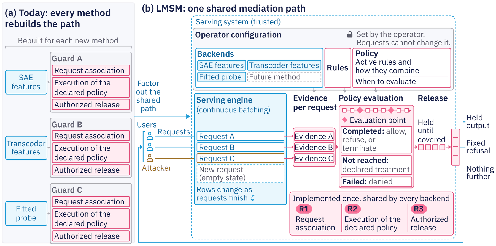
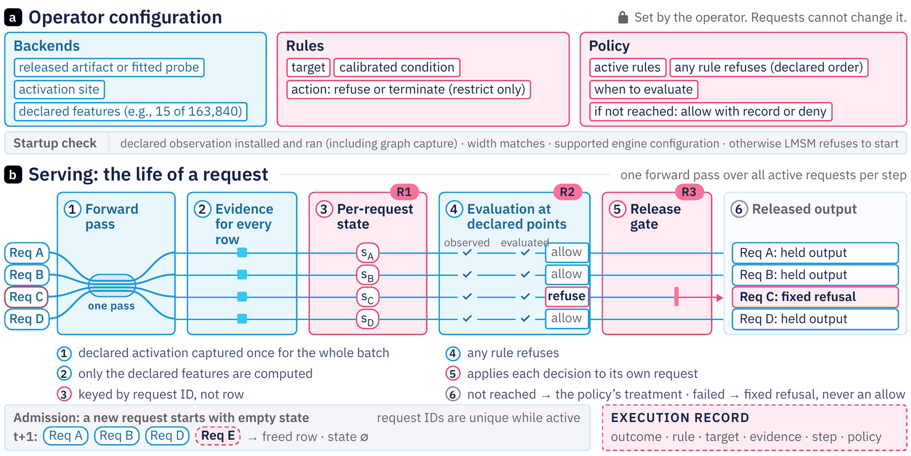

<div align="center">

# LMSM

### Language Model Security Modules

**Turning LLM interpretability into runtime defense**

[](https://arxiv.org/abs/2608.25697)
[](LICENSE)
[](pyproject.toml)
[](#vllm)

[Paper](https://arxiv.org/abs/2608.25697) ·
[Quick start](#quick-start) ·
[Profiles](#included-profiles) ·
[Reproduce the paper](paper/README.md) ·
[Cite](#citation)

</div>

<p align="center">
  
</p>

Interpretability methods such as probes, sparse autoencoders (SAEs) and transcoders read a model's activations (the hidden states it computes at each layer) and expose signals of harmful content while the model generates a response.
However, such a signal does not protect anything on its own.
To turn it into a defense, the serving system must also match each signal to the request that produced it, run the policy exactly as declared, and release a response only when the policy allows it.

**The key idea of LMSM is to handle these three duties once, in the serving system, instead of rebuilding them for each interpretability method.**
Specifically, an operator plugs in backends and a policy.
Backends turn activations into evidence, such as a probe score or the values of selected transcoder features.
The policy then uses that evidence to decide whether each response may reach the user.
Backends and policies can change while the rest of LMSM remains unchanged, much as Linux Security Modules let security policies change around fixed kernel hooks.

## What LMSM guarantees

LMSM provides each request with three guarantees, called R1 to R3 in the paper.

| | Guarantee | What LMSM does |
|---|---|---|
| R1 | **Request association** | LMSM stores evidence under the request ID that the serving engine assigns. Therefore, a decision never uses another request's activations, even when vLLM runs many requests in the same batch. |
| R2 | **Execution of the declared policy** | Each policy declares which tokens it must observe and when it evaluates. LMSM checks that each of these steps took place and writes an execution record with the request's execution state when the request finishes. |
| R3 | **Authorized release** | A response reaches the user only when the policy and the execution state allow it. If the evidence a policy requires is incomplete, LMSM fails closed and returns a fixed refusal instead of the response. |

## How it works

<p align="center">
  
</p>

An operator describes a deployment in one YAML profile with four parts.

- A **target** names one behavior to detect in the released response, such as cybercrime or unauthorized intrusion.
- A **backend binding** names a backend (a fitted probe, an SAE or a transcoder) and the layer whose activations it reads.
- A **rule** links one target to a backend's output, a calibrated threshold and an action, such as refusing the response.
- A **policy** chooses the active rules, when to evaluate them (its schedule), how to combine them and which runtime action each decision triggers. The included policies combine their rules with a fixed OR (the policy acts if any active rule fires).

Because rules are independent, a policy can use any subset of them without changing the backend.
For example, the excerpt below defines a rule that refuses a response once feature 44293 of a released transcoder exceeds its calibrated threshold.

```yaml
# Excerpt from profiles/lmsm_transcoder.yaml, some fields omitted
backend_bindings:
- id: qwen3_layer_24_transcoder
  type: transcoder
  activation_key: pre:model.layers.24.mlp
  artifact:
    source: hf_hub
    repo_id: mwhanna/qwen3-4b-transcoders
    filename: layer_24.safetensors

rule_library:
  rules:
  - id: cybercrime_intrusion
    target: cybercrime_intrusion
    binding: qwen3_layer_24_transcoder
    condition:
      type: feature_group
      channel: cybercrime_intrusion.features
      config:
        feature_indices: [44293]
        feature_thresholds: [2.21875]
    candidate_action: refuse

policy:
  name: LMSM-Transcoder
  active_rules: [chemical_biological, cybercrime_intrusion, illegal_activity]  # and three more
  schedule: {type: anytime, pooling: cumulative_feature_maxima, first_crossing: true}
  composition: {type: fixed_or, tie_break: active_rule_order}
  action_mapping: {refuse: refuse}
  execution: {not_reached: allow_with_record}
```

With vLLM, LMSM writes an execution record for each finished request.
A shortened record of a request that this policy refused at generation step 12 looks like this.

```json
{
  "request_id": "req-7",
  "policy_name": "LMSM-Transcoder",
  "state": "completed",
  "decision": "refuse",
  "decision_step": 12,
  "release_outcome": "refusal",
  "missing_observation_steps": [],
  "runtime_failures": []
}
```

Here, the state is `completed` because each declared observation and evaluation took place.
The release outcome `refusal` shows that the user received the fixed refusal instead of the model's response.
The other two states are `not_reached`, for a response that ends before the policy's first evaluation, and `execution_failed`, for a request whose required evidence is incomplete.

## Quick start

LMSM requires Python 3.10 or newer.

```bash
git clone https://github.com/xiuyuz/LMSM.git
cd LMSM
python -m pip install -e '.[hf]'        # Transformers
python -m pip install -e '.[hf,vllm]'   # vLLM 0.19.0
python -m pip install -e '.[hf,sae]'    # SAE backend (sae-lens)
```

### Transformers

The Transformers engine is a simple reference implementation.
It serves one request at a time and writes no execution records.

```python
from pathlib import Path

from transformers import AutoModelForCausalLM, AutoTokenizer

from lmsm import build_transformers_engine, load_profile

root = Path("/path/to/LMSM")
model_id = "Qwen/Qwen3-4B"
profile = load_profile(root / "profiles/lmsm_anytime.yaml")
tokenizer = AutoTokenizer.from_pretrained(model_id)
model = AutoModelForCausalLM.from_pretrained(model_id, device_map="auto")

engine = build_transformers_engine(model, tokenizer, profile, root)
print(engine.generate("Explain how photosynthesis works."))
```

To run only some of the rules, pass `profile.with_active_rules(["chemical_biological", "cybercrime_intrusion"])` instead of `profile`.
To evaluate the policy without changing any response, pass `actions_enabled=False` to `build_transformers_engine`.

### vLLM

`examples/run_vllm.py` reads requests from a JSONL file with `id` and `prompt` fields.
It writes the responses (`outputs.jsonl`), the policy actions (`actions.jsonl`), the execution records (`execution_records.jsonl`), the timings (`timings.csv`) and the run settings (`metadata.json`) to the run directory.

```bash
python examples/run_vllm.py \
  --model Qwen/Qwen3-4B \
  --profile profiles/lmsm_anytime.yaml \
  --input examples/requests.jsonl \
  --run-dir runs/anytime \
  --physical-gpu 0
```

- `--mode compiled --observation graph` keeps vLLM's compiled execution and CUDA graphs, and `--evaluation device` evaluates the policy on the GPU without a host sync at each step.
- With `--evaluation device`, adding `--async-scheduling --engine-process mp --enable-prefix-caching --enable-chunked-prefill` also turns on vLLM's default optimizations.
- `--active-rule RULE_ID` runs only the named rule. Repeat it to run several rules.
- `--observe-only` evaluates and records the policy without acting on it.

The vLLM integration supports one worker (tensor and pipeline parallel size 1).
It takes the layer to read from the backend binding and the hidden size from the loaded model.

## Included profiles

| Profile | Rules | Schedule |
|---|---|---|
| `lmsm_checkpoint.yaml` | 15 rules on fitted probes, Qwen3-4B | Checkpoint. Averages over the prompt and two windows of generated tokens (1 to 32 and 33 to 64), then decides once, at token 64, from their combined scores |
| `lmsm_anytime.yaml` | 15 rules on fitted probes, Qwen3-4B | Anytime. Rescores the response so far at each generated token and acts at the first threshold crossing |
| `lmsm_transcoder.yaml` | 6 rules on a released transcoder (`mwhanna/qwen3-4b-transcoders`, layer 24), Qwen3-4B | Anytime, over the running maximum of each feature |
| `lmsm_sae.yaml` | 6 rules on a released Gemma Scope SAE (layer 22), Gemma-3-4B | Anytime, over the running maximum of each feature |
| `lmsm_transcoder_copyright.yaml`, `lmsm_sae_copyright.yaml` | only the two copyright rules of the transcoder or SAE profile | as in that profile |
| `lmsm_composed_all.yaml` | the 15 probe rules of `lmsm_checkpoint.yaml` and the 6 transcoder rules as one policy | each set keeps its own schedule, and a fixed OR combines them |
| `lmsm_composed_shared.yaml` | the 15 probe rules and the 3 transcoder rules whose targets match a probe target | as above |

The probe parameters are in `profiles/parameters/`, and LMSM downloads the transcoder and the SAE from the Hugging Face Hub.
`lmsm_composed_check_probe.yaml` and `lmsm_composed_check_transcoder.yaml` are test profiles, each of which turns off one set of rules in the composed policy and must reproduce `lmsm_checkpoint.yaml` or `lmsm_transcoder.yaml` exactly.

## Reproducing the paper

[`paper/`](paper/README.md) holds the scripts and data behind the paper's evaluation.
`python paper/show.py` prints each number in the paper's tables and figures from the included results, with Python alone.

```bash
python paper/show.py                        # every number
python paper/show.py effectiveness table5   # one table
```

Each folder's README explains how to recompute these numbers from the run outputs and how to rerun the experiments.
Rerunning all experiments takes about 16 hours on one NVIDIA H100 GPU, plus model loading and judging.

## Repository layout

```text
src/lmsm/   the library: profiles, backends, policy evaluation, Transformers and vLLM integrations
profiles/   deployment profiles (YAML) and the fitted probe parameters
examples/   the vLLM runner and example requests
paper/      scripts, data splits and results behind the paper's evaluation
tests/      the test suite
assets/     figures for this README
```

## Tests

```bash
python -m pip install -e '.[dev]'
python -m pytest -q
```

The suite runs on the CPU.
The tests in `tests/test_device_robustness_cuda.py` require a CUDA GPU and are skipped without one.

## Citation

If you find LMSM or our paper useful, please consider citing our work.

```bibtex
@misc{zhang2026lmsm,
  title         = {Language Model Security Modules: Turning LLM Interpretability into Runtime Defense},
  author        = {Zhang, XiuYu and Ruan, Bonan and Fang, Junfeng and Zhang, An and Chua, Tat-Seng and Liang, Zhenkai},
  year          = {2026},
  eprint        = {2608.25697},
  archivePrefix = {arXiv},
  primaryClass  = {cs.CR},
  url           = {https://arxiv.org/abs/2608.25697}
}
```

## License

The code and documentation are released under the MIT License.
The models and the downloaded transcoder and SAE keep their own licenses.
